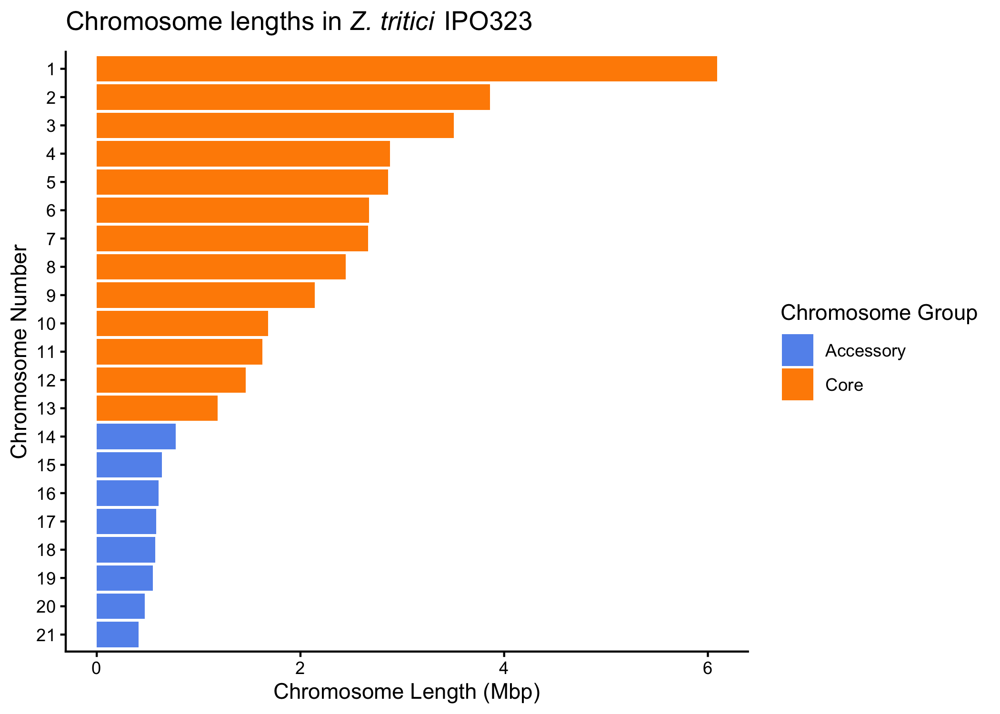
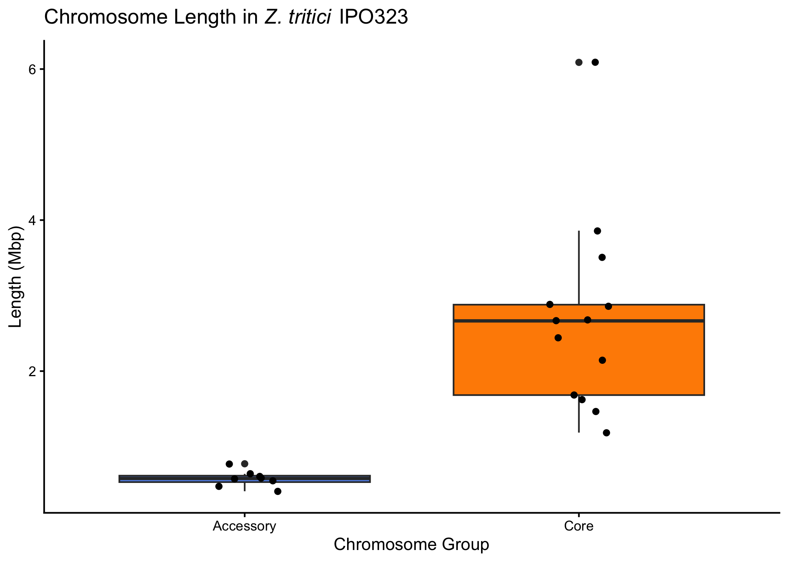
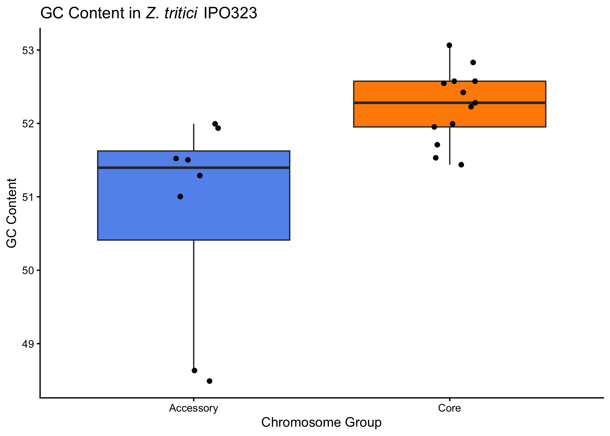
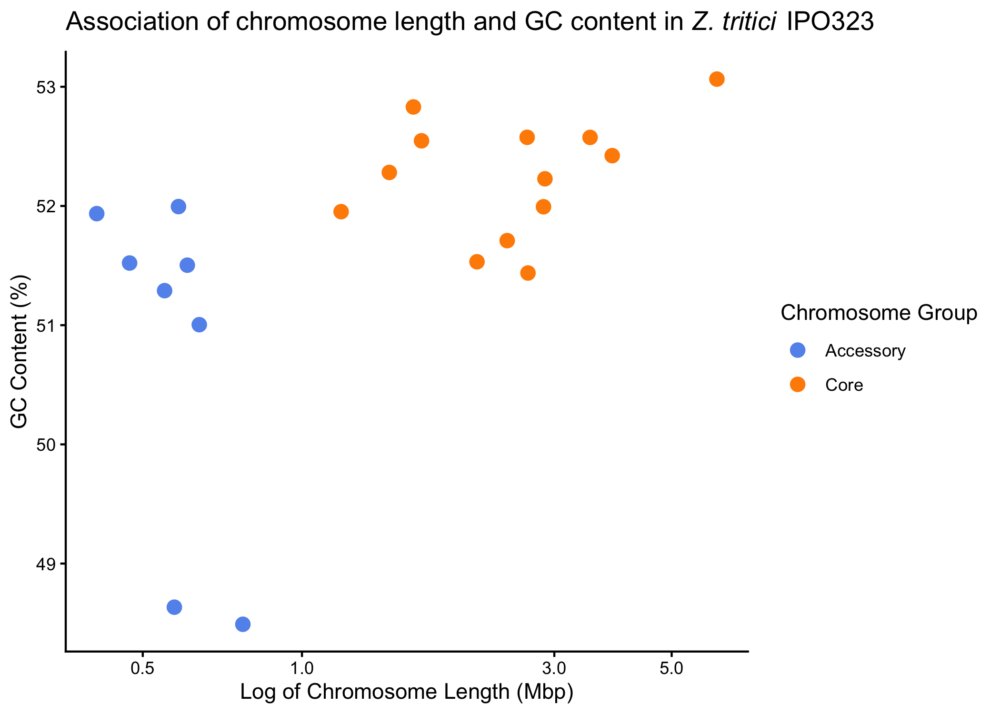

# zymoseptoria-genome-analysis
An investigation into the genomic characteristics of *Zymoseptoria tritici* IPO323, focusing on differences between core and accessory chromosomes.

## 1. Project Overview
This project explores the genomic characteristics of the wheat pathogen *Zymoseptoria tritici*. Basic chromosome-level statistics, including sequence length, GC content and the N50 statistic, were calculated from the genome assembly of the reference isolate IPO323. Core and accessory chromosomes were then compared to investigate differences in chromosome length and nucleotide composition.

## 2. Biological Background
*Zymoseptoria tritici* is a devastating fungal pathogen of wheat, causing Septoria tritici blotch, one of the significant diseases of wheat worldwide (Karisto et al. 2019). The IPO323 isolate is the reference strain of *Z. tritici*. The *Z. tritici* genome contains 13 core chromosomes, which is a generally conserved number across isolates, and a variable number of accessory chromosomes (Lapalu et al. 2025). Accessory regions are genomically plastic regions or dispensable whole chromosomes which can contain host specific virulence factors and are relevant to host-pathogen interactions (Bertazzoni et al. 2018; Glavincheska and Lorrain 2025). Accessory chromosomes may contribute to pathogenicity, host adaptation and host-pathogen interactions, making them relevant to studies of genome evolution and fungal adaptation.

## 3. Research Questions
The aim of this analysis is to characterize the IPO323 genome and explore differences between its core and accessory chromosomes. The following questions are considered in this analysis:
1. What are the basic genomic properties of the IPO323 reference genome?
2. How do chromosomal properties, like length and GC content, differ between core and accessory chromosomes?
3. Is there an association between chromosome length and GC content?

## 4. Data Sources
The genome assembly used in this analysis was obtained from NCBI for Zymoseptoria tritici isolate IPO323. 
- Assembly: MYCGR v2.0 
- Assembly accession: GCA_000219625.1 
- Data repository: NCBI 
- Data files: Genome FASTA and GFF3 annotation 

The genome assembly was downloaded using the NCBI Datasets command-line tool. Raw genome data are stored locally in `data/raw/` and are excluded from version control. Although the annotation was downloaded, it was not used in this analysis.

[NCBI Genome Assembly - GCA_000219625.1](https://www.ncbi.nlm.nih.gov/datasets/genome/GCA_000219625.1/)

## 5. Methods

### 5.1 Data Acquisition
The data used in this analysis were downloaded from NCBI Datasets. The assembly used was *Zymoseptoria tritici* isolate IPO323, assembly name MYCGR v2.0 (accession: GCA_000219625.1). The FASTA and GFF3 files were downloaded using the NCBI Datasets command-line tool and retained in `data/raw/`. Raw data were excluded from version control.

### 5.2 Genome Statistics
Biopython was used to read the FASTA file and generate the following chromosome-level statistics: 
- Chromosome length: The number of nucleotide bases in each chromosome 
- GC content: The percentage of bases that are G or C 
- Total genome length: The sum of all chromosome lengths 
- Mean chromosome length: Average length of the 21 chromosomes 
- Median chromosome length: Middle chromosome length 
- Minimum and maximum chromosome length: Shortest and longest chromosomes 
- N50: The sequence length at which 50% of the total assembly length is contained in sequences of that length or longer. 
  
An important note is that the 21 chromosome-level sequences were used in these calculations, rather than the underlying 24 contigs. Consequently, the N50 represents chromosome-level sequence continuity. The python script genome_analysis.py exports these chromosome-level statistics to `data/processed/chromosome_statistics.csv`, which was then used in the subsequent R analysis. 

### 5.3 Statistical Analysis and Visualisation
Statistical analysis and visualization were done in R with the ggplot2 package. The `chromosome_statistics.csv` file that was generated as an output from the `genome_analysis.py` script was imported. The accessions and chromosome numbers were extracted from the FASTA headers and used to classify chromosomes 1-13 as core and chromosomes 14-21 as accessory. The chromosome classification of core or accessory was based solely on chromosome number. Then this classification information was merged with the chromosome statistics. Descriptive statistics were calculated for each chromosome group, then visualizations were generated to explore length and GC content. The four visualizations generated were: a ranked chromosome length barplot, a boxplot comparing core and accessory chromosome lengths, a boxplot comparing core and accessory chromosome GC content, and finally a scatterplot showing the association between chromosome length and GC content.

### 5.4 Statistical Testing
I used a two-sided Wilcoxon Rank-Sum test (`wilcox.test()` in R) to compare the distributions of GC content for core and accessory chromosomes. The significance threshold was set at α = 0.05. It should be acknowledged here that this was an exploratory comparison of chromosomes within a single reference genome, not a comparison of independent biological replicates. The results should therefore be interpreted in the context of this particular genome.

## 6. Results

### 6.1 General Genome Assembly Characteristics
The IPO323 genome assembly comprised 21 chromosome-level sequences, with a total length of 39.69 Mbp and an overall GC content of 52.14% (Table 1).
| Metric | Value |
|---|---:|
| Number of chromosomes | 21 |
| Total genome length | 39,686,251 bp |
| Mean chromosome length | 1,889,821 bp |
| Median chromosome length | 1,624,292 bp |
| Overall GC content | 52.14% |
| Chromosome-level N50 | 2,674,951 bp |

**Table 1.** General genome assembly metrics of *Z. tritici* IPO323.

### 6.2 Core and Accessory Chromosome Lengths
There are 13 core and 8 accessory chromosomes in isolate IPO323. The core chromosomes range in lengths from 1,185,774 bp - 6,088,797 bp, while the accessory chromosomes range in lengths from 409,213 bp - 773,098 bp. The length ranges of the two groups do not overlap; all accessory chromosomes are shorter than the shortest core chromosome. The mean and median lengths for core chromosomes are 2,698,280 bp and 2,665,280 bp, respectively, while mean and median lengths for accessory chromosomes are 576,075.6 bp and 578,898.5 bp, respectively. There is a noticeable jump in the ranked barplot (Figure 1) from core to accessory chromosomes, showing that the longest accessory chromosome is substantially shorter than the shortest core chromosome. The boxplot further illustrates the narrower distribution of accessory chromosome lengths compared with core chromosome lengths (Figure 2).

**Figure 1.** Ranked barplot of chromosome lengths of *Z. tritici* IPO323, grouped as core (orange) or accessory (blue) chromosomes. There is a clear separation between the two groups, with the longest accessory chromosome shorter than the shortest core chromosome.

**Figure 2.** Boxplot comparing length of core (orange) and accessory (blue) chromosomes of *Z. tritici* IPO323. Accessory chromosomes have a narrower distribution of length than core chromosomes.

### 6.3 GC Content Comparison
The mean and median GC content was 52.2% and 52.3%, respectively, for core chromosomes. The mean and median GC content was 50.8% and 51.4%, respectively, for accessory chromosomes. The standard deviation in GC content was 0.496 percentage points for core chromosomes and 1.42 percentage points in accessory chromosomes. Accessory chromosomes showed greater variation in GC content, as reflected by the larger interquartile range in Figure 3. A two-sided Wilcoxon rank-sum test identified a statistically significant difference in GC-content distributions between core and accessory chromosomes (W = 10, p = 0.001337).

**Figure 3.** Boxplot comparing GC content of core (orange) and accessory (blue) chromosomes of *Z. tritici* IPO323. The variation of GC content among accessory chromosomes looks larger than that of core chromosomes.

### 6.4 Relationship between Chromosome Length and GC Content
The length difference between core and accessory chromosomes makes two distinct clusters appear in Figure 4. Among accessory chromosomes, GC content ranges from 51-52%, except for two chromosomes with substantially lower GC content (~48%). Among core chromosomes, a moderate positive association was observed between chromosome length and GC content (Pearson’s r = 0.418; Figure 4).

 **Figure 4.** Scatterplot comparing GC content and length of core (orange) and accessory (blue) chromosomes of *Z. tritici* IPO323. There is a slight positive association between length and GC content among core chromosomes.
 
## 7. Discussion

### 7.1 General genome characteristics
The IPO323 genome consisted of 21 chromosome-level sequences with a total assembly length of 39.69 Mbp and an overall GC content of 52.14%. These figures are consistent with published values for the genome assembly of *Z. tritici* IPO323 (Goodwin et al. 2011). 

### 7.2 Differences between core and accessory chromosomes
Pathogenic fungi can possess lineage-specific, variable regions that can cover entire chromosomes, known as accessory chromosomes (Croll and McDonald 2012). While the core genome carries genes necessary for basal functions, the accessory genome exhibits greater variation in presence, chromosome structure and gene content between isolates (Bertazzoni et al. 2018). The difference between the compartments is known as the 2-speed genome model (Croll and McDonald 2012; Bertazzoni et al. 2018). In this analysis, all accessory chromosomes of *Z. tritici* IPO323 were shorter than the shortest core chromosome. This is consistent with the distinct evolutionary characteristics of accessory chromosomes. Accessory chromosomes possess high repeat content, are structurally unstable, and contain relatively fewer genes than core chromosomes (Vanden 2025). Therefore, the chromosome-length differences observed in this analysis demonstrate structural differentiation between the two genomic compartments but do not establish a direct relationship between chromosome length and pathogenicity.

### 7.3 Differences in GC content
The analysis revealed lower GC content in accessory chromosomes compared with core chromosomes, with a statistically significant difference between their GC content distributions according to the Wilcoxon rank-sum test. This difference could be merely reflective of a difference in gene density or repeat content, or it could be indicative of distinct evolutionary origins, for example, horizontal acquisition events (Yang et al. 2020; Vanden 2025). However, the mechanisms underlying the observed GC-content difference cannot be determined from the present analysis and require further investigation.

### 7.4 Relationship between chromosome length and GC content
In this analysis, a moderate positive association was found between chromosome length and GC content in core chromosomes. This finding is consistent with existing literature on the association between chromosome length and GC content in fungi (Li and Du 2014). However, the relationship observed here is relatively moderate and may be influenced by other genomic characteristics, such as gene density or repeat content. Further analysis would be required to determine the factors underlying this association.

## 8. Limitations
A few limitations of this analysis should be considered when interpreting its findings. First, only one isolate was analyzed, so observed patterns and differences might not apply to other *Z. tritici* isolates. Second, chromosomes are not independent biological replicates and therefore the p-value obtained from the Wilcoxon rank-sum test should be interpreted with caution. This test acts solely as an exploratory comparison within a single genome. Third, gene annotation was not analysed, preventing investigation of gene density and functional differences between chromosome groups. Repeat content was also not quantified, limiting the ability to investigate its potential contribution to chromosome structure and nucleotide composition. Future research could address these limitations through comparative analyses of multiple *Z. tritici* isolates and more detailed investigations of chromosome content. Gene density analysis could reveal differences in gene distribution on the core and accessory chromosomes and investigate their relationship with GC content. Functional enrichment analysis could investigate whether genes located on accessory chromosomes are enriched for functions associated with pathogenicity, host interactions or environmental adaptation. Additionally, investigating repetitive DNA content could provide further insight into the structural and evolutionary differences between the two chromosome groups.

## 9. Reproducibility

### 9.1 Software and Dependencies
The analysis was performed using Python and R. Python dependencies are listed in requirements.txt and include Biopython, pandas and matplotlib. The R analysis uses ggplot2 for visualisation and dplyr for data manipulation. The NCBI Datasets command-line tool was used to download the genome assembly.
- Python version 3.14.3
- R version 4.5.2 
- Biopython version 1.88
- pandas version 3.1.1
- matplotlib version 3.11.2
- ggplot2 version 4.0.3
- dplyr version 1.2.1
- NCBI datasets version 18.41.0

### 9.2 Repository Structure
- `scripts/genome_analysis.py`: Calculates genome and chromosome statistics from the genome FASTA.
- `scripts/chromosome_stat_vis.R`: Performs chromosome comparisons and generates visualisations.
- `data/raw/`: Original downloaded genome files.
- `data/processed/`: Processed chromosome statistics.
- `results/figures/`: Generated visualisations.
- `requirements.txt`: Python dependencies.

### 9.3 Reproducing the analysis
1. Clone the repository and navigate to the project directory
2. Create and activate a Python virtual environment:  
`python3 -m venv .venv`  
`source .venv/bin/activate`  
`pip install -r requirements.txt`   
4. Install Python dependencies using requirements.txt
5. Download the genome assembly GCA_000219625.1 from NCBI using the Datasets CLI and place the genome FASTA file in `data/raw/IPO323/`
6. Run the Python analysis:  
`python scripts/genome_analysis.py`
7. Run the R analysis:  
`Rscript scripts/chromosome_stat_vis.R`

### 9.4 Expected outputs
The Python script generates `data/processed/chromosome_statistics.csv`, containing chromosome-level statistics.

The R script generates the following figures in `results/figures/`:

`ranked_chromosome_length.png`

`length_core_accessory.png`

`gc_content_core_accessory.png`

`gc_content_by_length.png`

The scripts can be rerun to regenerate the processed data and visualisations.
## 10. References
Bertazzoni S, Williams AH, Jones DA, Syme RA, Tan K-C, Hane JK. 2018. Accessories Make the Outfit: Accessory Chromosomes and Other Dispensable DNA Regions in Plant-Pathogenic Fungi. Mol. Plant-Microbe Interactions® 31:779–788. 

Croll D, McDonald BA. 2012. The Accessory Genome as a Cradle for Adaptive Evolution in Pathogens. PLOS Pathog. 8:e1002608. 

Glavincheska I, Lorrain C. 2025. Three-dimensional genome architecture connects chromatin structure and function in a major wheat pathogen. :2025.05.13.653796. Available from: https://www.biorxiv.org/content/10.1101/2025.05.13.653796v2 

Goodwin SB, M’Barek SB, Dhillon B, Wittenberg AHJ, Crane CF, Hane JK, Foster AJ, Lee TAJV der, Grimwood J, Aerts A, et al. 2011. Finished Genome of the Fungal Wheat Pathogen Mycosphaerella graminicola Reveals Dispensome Structure, Chromosome Plasticity, and Stealth Pathogenesis. PLOS Genet. 7:e1002070. 

Karisto P, Dora S, Mikaberidze A. 2019. Measurement of infection efficiency of a major wheat pathogen using time-resolved imaging of disease progress. Plant Pathol. 68:163–172. 

Lapalu N, Lamothe L, Petit Y, Genissel A, Delude C, Feurtey A, Abraham LN, Smith D, King R, Renwick A, et al. 2025. Improved Gene Annotation of the Fungal Wheat Pathogen Zymoseptoria tritici Based on Combined Iso-Seq and RNA-Seq Evidence. Mol. Plant. Microbe Interact. 38:834–847. 

Li X-Q, Du D. 2014. Variation, Evolution, and Correlation Analysis of C+G Content and Genome or Chromosome Size in Different Kingdoms and Phyla. PLOS ONE 9:e88339. 
Vanden M. 2025. Accessory Chromosomes as Dynamic Reservoirs of Virulence and Adaptation in Fungal Genomes. Fungal Genomics Biol. 15:1–2. 

Yang H, Yu H, Ma L-J. 2020. Accessory Chromosomes in Fusarium oxysporum. Phytopathology® 110:1488–1496. 

